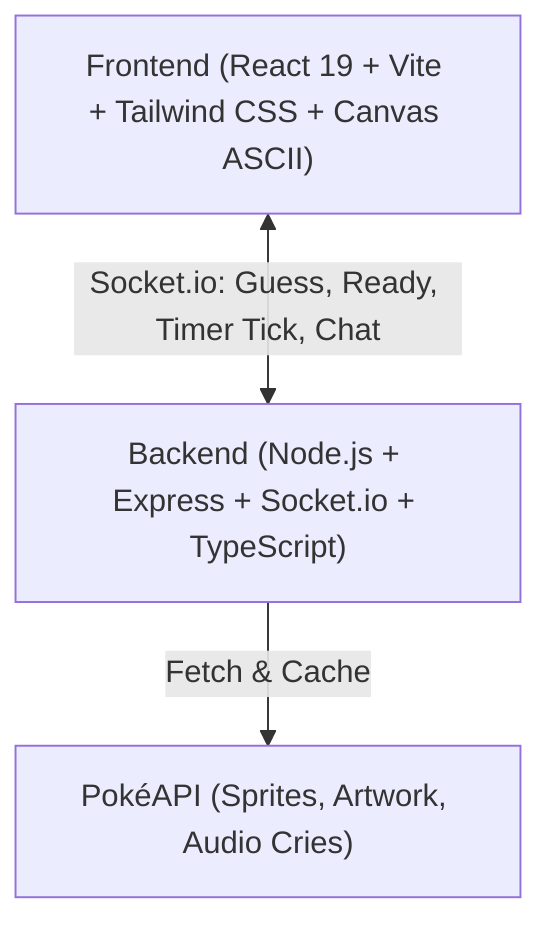

<p align="center">
  
</p>

<h1 align="center">Who's That Pokémon? 🔍 (Full-Stack Multiplayer & ASCII Edition)</h1>

<p align="center">
  A modern, real-time multiplayer party game and nostalgic tribute to the iconic Pokémon anime segment — featuring high-definition silhouette unmasking, authentic audio cries, live buzzer speed-scoring, and an awesome <b>Retro CRT ASCII Art Mode</b>!
</p>

---

## 🌟 What's New in v2.0 (Full-Stack Multiplayer Edition)

- 👥 **Real-Time Multiplayer Lobbies**: Create or join rooms with 4-letter codes (e.g., `PIKA`, `BULB`). Play with friends on desktop or mobile!
- 🎨 **Authentic PokéDex UI**: Sunburst anime background, pulsing blue sensor LED, and high-precision silhouette unmask transitions.
- 📟 **Retro CRT ASCII Art Mode**:
  - Toggle between **HD Anime Mode** and **Phosphor Green / Full-Color ASCII Art** on the fly.
  - Generates colored monospace ASCII art directly from any Pokémon sprite.
  - Includes a dedicated **"Terminal ASCII Spec"** tab with a 1-click **"Copy ASCII"** button.
- ⏱️ **Live Speed-Scoring & Streaks**: Faster correct guesses earn up to 200 points per round with compounding streak combo multipliers!
- 🔊 **Web Audio & Authentic Cries**: Synthesized retro timer ticks and chimes + official Pokémon voice cries streamed directly from PokéAPI.
- 💬 **Live Chat & Emoji Reactions**: Taunt and celebrate with friends in real-time (`🔥`, `⚡`, `🎉`, `😭`, `😱`).
- 🏆 **Podium & Confetti Finale**: Automatic MVP tracking, gold/silver/bronze podium, and tournament celebration!
- 🐍 **Classic Python CLI Preserved**: The original terminal game script (`pokemon.py`) remains intact in the root directory.

---

## 🚀 Quickstart Guide

### Prerequisites
- [Node.js](https://nodejs.org/) (v18 or newer)
- [Python 3.8+](https://www.python.org/) *(only needed if you want to run the legacy CLI version)*

---

### Option A: Run the Modern Full-Stack Web App (Recommended)

1. **Clone the repository:**
   ```bash
   git clone https://github.com/Dyspropie/Who-s_that_Pokemon.git
   cd Who-s_that_Pokemon
   ```

2. **Start the Backend Server (Port 3001):**
   ```bash
   cd server
   npm install
   npm run dev
   ```

3. **In a second terminal, start the Frontend (Port 5173):**
   ```bash
   cd client
   npm install
   npm run dev
   ```

4. **Play!** Open your browser to `http://localhost:5173`.
   - Click **Host New Multiplayer Room** to get a 4-letter code.
   - Open another tab or device to `http://localhost:5173`, enter the code, and battle your friends!
   - Or click **Solo Practice Mode** for instant single-player action.

---

### Option B: Run the Classic Python CLI Version

The original terminal version is preserved:

1. **Install Python dependencies:**
   ```bash
   pip install -r requirements.txt
   ```

2. **Run the game:**
   ```bash
   python pokemon.py
   ```

---

## 🛠️ Architecture & Tech Stack



- **Frontend**: React 19, Vite, Tailwind CSS v4, Lucide Icons, Canvas Confetti, Web Audio API Synthesizer.
- **Backend**: Node.js, Express, Socket.io, TypeScript (`tsx`).
- **Data & Audio**: PokéAPI (official sprites, high-res artwork, and audio cries).

---

## 🙋 Author

Made with ❤️ by [@Dyspropie](https://github.com/Dyspropie)

---

## 📜 License

This project is licensed under the [MIT License](License.md).
